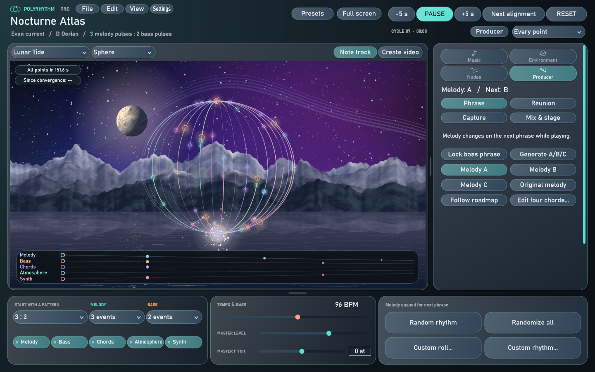
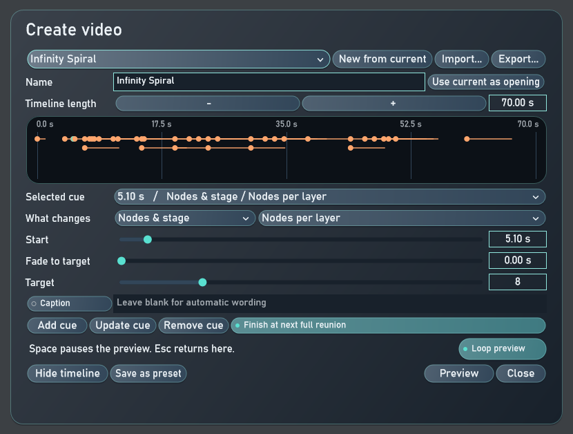

# PolyRhythm Pro

**Play a polyrhythm you can follow with your eyes.** Give a felt piano three pulses against a bass line’s two. Each point leaves the same gate, follows its own phrase, and returns when its note sounds. When every active point finally arrives together, the instruments resolve and the landscape responds.


**Windows x64 standalone instrument** · Five musical layers · Six procedural environments · MIDI, stereo stems and PNG export

[Build and launch](#build-and-launch-on-windows) · [First performance](#play-your-first-performance) · [Producer](#perform-with-producer) · [Capture and export](#capture-and-export) · [Video sequences](#direct-a-video-sequence)

## Play your first performance

1. Choose **Presets → Nocturne Atlas** and press **Play**. Leave just **Melody** and **Bass** enabled to hear the 3:2 pattern clearly, then bring Chords, Atmosphere and Synth back in. Their settings stay put while muted.
2. Choose **Aurora Loom** above the stage and **Lotus** as the convergence target. Raise **Nodes → Fan spread**. Watch the note track: it shows approaching attacks, and the layer name lights up as its note lands.
3. Select **Every point**, then **Next alignment**. Playback jumps to the *approach*, not past the impact. Compare it with **Layer attacks**, which looks for a shared layer hit rather than a meeting of every node.



## Shape the instrument

| Where | What you can change |
| --- | --- |
| **Playing controls** | Start with one of 24 ratios or set the melody and bass counts directly. Tempo spans **1–180 BPM**; master pitch transposes the ensemble without erasing layer offsets. **Reset** rewinds the current piece. **Random rhythm** generates another; **Custom rhythm** lets you choose its counts, groove and motion. |
| **Music → Score / Pitches** | Assign any of 14 synthesized instruments, from felt piano and celesta to sub sine, Prism lead and Solar brass. Adjust gain, release, octave, multiplier and hit chance. Give nodes distinct pitches, group several on one note, or use an ensemble voicing. On Chords, compare a triad, inversion, suspended second, seventh or stacked fourths as single tones, a block or a roll. |
| **Music → EQ / Space / Acoustics / Cloud** | Shape each layer with filter and shelves, reverb, echo and chorus. Compare **Velvet chamber** with **Glacial hall**. Cloud grains draw from the layer’s own sound; vary their density, length, pitch range, feedback, shimmer and reverse. |
| **Nodes** | Set **1–32 points per layer** (up to 160 total). In variable-speed mode, strands travel their paths in different times. In equal-speed mode, a longer wait means a longer route. Adjust reunion spacing, orbit distance, per-layer placement and auto-balance. Edit hue, size, halo and trails for one layer or all; select rigid trails for sharp corners, elastic for flowing bends. Sync threads can be hidden without muting notes. |
| **Environment → Sky / Motion** | Adjust star count (up to 6,000), twinkle, drift, hue cycling and parallax independently of the music. Each scene has its own controls and reunion: paired flares in **Eclipse Garden**, dancing curtains in **Aurora Loom**, a swell in **Lunar Tide**, an underwater shoal in **Lantern Deep**, windblown sand in **Saffron Dunes**, and illuminated ice in **Glacier Cathedral**. |

**Try a different silhouette without changing the music:** use the target selector for a rail, infinity, lotus, sphere, heart, DNA helix, cube or pyramid. Targets choose a suitable starting motion; you can override it in Nodes. For a whole arrangement instead, load **Velvet Valentine**, **Helix Current**, **Glass Box** or **Sun Temple** from Presets.

## Perform with Producer

Open **Producer** in the four-button inspector or beside the transport clock. Its readout distinguishes the melody you hear from the one queued for the next phrase.

- **Phrase:** Lock the last completed bass phrase, generate melody variants **A/B/C**, then switch between them without breaking the pulse. **Edit four chords** gives the piece a harmonic route: try Dm9 → B♭maj7 → F → Cadd9, two cycles per chord.
- **Reunion:** Resolve to the home chord, lift reverb for two beats, or open the fan. **After: settle back** returns to your original spread over two more beats; **After: stay open** makes 100% the new spread.
- **Mix & stage:** Store mixes A and B while playing. Compare their levels and effects with RMS matching when both have signal; **Return to prior mix** restores your starting balance. Click a moving head to audition and pin its strand. **Frame shots** sets the close-up and pullback to reunion; **Portrait guide** marks a 9:16 crop without changing the render.
- **Capture:** Catch notes you already heard, render audio from the current position, freeze a constellation, or record live control moves. The outputs are different by design.

## Capture and export

| Want to keep… | Use | What you get |
| --- | --- | --- |
| **The notes you just heard** | **Producer → Capture → MIDI since reunion** (default **Ctrl+Shift+M**), **MIDI last 30 s** or **MIDI last pass** | Five named MIDI tracks of performed attacks, including rolled offsets and chance rests. Note lengths approximate the synth envelopes; effects are not MIDI. History holds the last 65,536 attacks and clears on seek/reset. |
| **The sound, ready for a DAW** | **Render five stems** | Five aligned stereo **48 kHz / 24-bit WAVs**. This renders *forward*: 16 seconds of notes plus eight seconds of tails, with fresh effect buffers. Import all files at the same position. They include layer FX, pan and gain, before the combined output soft clipper. |
| **A still of the performance** | Hold **E** or choose **Expose to reunion**, then **Save exposure PNG** | Sounded notes leave stars along their strands. Release E or reach a reunion to freeze the in-memory image; saving writes the PNG even after the live glow fades. |
| **Your control movements** | **Record automation → Finish take** | An editable sequence with an opening patch and timed control targets, not an audio recording. Choose **Save as preset** to keep it. |

File receipts show the actual destination with **Copy path** and **Show location**. **Producer → Capture → Open exports** opens the export folder. An in-memory capture is labeled as such until you save it.

## Direct a video sequence

Open **Create video → Infinity Spiral → Edit timeline**. Follow the celesta from an opening strand into a 120-node reunion, then back to the beginning. **Firefly Float**, **Infinity bloom**, **Silk in motion** and **Tidal echoes** offer different arrangements to preview or edit.



Choose **New from current** to author your own. Set a timeline length, click a marker or an empty time, choose a setting and target, and add an optional caption. Numeric controls can ease over a transition; instruments and switches change on cue. The **30 fps timeline** sets authoring precision, not the stage refresh rate. **Use current as opening** replaces only the starting patch.

**Finish at next full reunion** waits for a musical event, not a guessed timestamp. Enable **Loop preview** for repeated takes. **Space** pauses preview; **Esc** restores your live performance. Save a copy or exchange a sequence through **Import / Export** XML. For moving pictures, capture fullscreen preview with a screen recorder: the app does **not** encode a video file or host plug-ins.

## Make it yours

- **Save a performance, not just a ratio.** Presets store the musical arrangement and scene together. Use **File** to import/export performance XML or rename, update and remove saved entries. **Settings → Save startup defaults** remembers selected controls *without* changing the current piece; **Load defaults** applies them.
- **Experiment without losing your place.** **Randomize all** protects tempo, master level, tuning and layer switches. **Custom roll** lets you pick parameters and ranges. Right-click a live knob or slider for a factory reset; undo/redo performance edits with **Ctrl+Z / Ctrl+Y**.
- **Set up the workspace.** Resize the inspector and bottom dock, toggle the note track, or adjust its height in Settings. **View → Appearance** changes theme, typeface, corners, borders and drop-down styling without recoloring your performance. **Settings → Keyboard shortcuts** lets you assign Producer and transport actions; **Save shortcuts** applies them across launches.
- **For recording**, use **F11** for fullscreen. **View → Show stage FPS** reports the live stage rate. Scenery caching keeps fine motion separate from slower sky redraws; actual frame rate depends on the scene, window size, renderer and hardware.

## Build and launch on Windows

Install **Git** and **Visual Studio 2026** with the **Desktop development with C++** workload, Windows SDK and C++ CMake tools. From Developer PowerShell:

```powershell
git clone https://github.com/moeabuseini/PolyRhythm-Pro.git
cd PolyRhythm-Pro
cmake --preset windows-release
cmake --build --preset windows-release --parallel 4
.\Run-PolyRhythmPro.cmd
```

Already cloned? Start in the folder containing [CMakePresets.json](CMakePresets.json) and skip the first two commands. The first configure fetches **JUCE 9.0.6**. To use an existing JUCE tree, configure with `cmake --preset windows-release "-DFETCHCONTENT_SOURCE_DIR_JUCE=C:\path\to\JUCE"` and point it at the folder containing JUCE’s `modules` and `CMakeLists.txt`.

The [launcher](Run-PolyRhythmPro.cmd) works from any directory: `& "C:\path\to\PolyRhythm-Pro\Run-PolyRhythmPro.cmd"`. It prefers Release and falls back to Debug. For breakpoints, configure and build **windows-debug**, then use Visual Studio’s debugger or launch with `--debug`. If CMake isn’t on PATH, Visual Studio Community includes it under `%ProgramFiles%\Microsoft Visual Studio\18\Community\Common7\IDE\CommonExtensions\Microsoft\CMake\CMake\bin`.

**Troubleshooting:** If Play reports no output, select or reconnect a Windows audio output and restart the app. For a crash, use **Settings → Open diagnostics folder**; match the session log with its minidump if one was produced. Presets and preferences live under `%APPDATA%\PolyRhythm Pro`. Diagnostics stay local.

## Inside the repository

| Directory | Responsibility |
| --- | --- |
| [Source/App](Source/App) · [Studio](Source/Studio) | Application startup, device and window lifecycle, transport controls, settings catalogue, presets and undo history |
| [Source/Rhythm](Source/Rhythm) · [Audio](Source/Audio) | Shared beat grid and node voicings; sample-timed synthesis, per-layer DSP and performed-note journal |
| [Source/Stage](Source/Stage) · [UI](Source/UI) | Procedural environments, paths and hit effects; inspectors, theme and reusable controls |
| [Source/Producer](Source/Producer) · [Video](Source/Video) | Phrase and mix tools, shortcuts and exports; sequence editing and playback |
| [Presets/Video](Presets/Video) · [docs/screenshots](docs/screenshots) | Embedded XML scores and screenshots captured from the app |

Build the root [CMake project](CMakeLists.txt); `JUCE-Assets/` is the earlier Projucer scaffold, not the standalone instrument. The project uses original procedural artwork and synthesized sounds.

[Project license](LICENSE) · [JUCE license](https://github.com/juce-framework/JUCE/blob/9.0.6/LICENSE.md)
